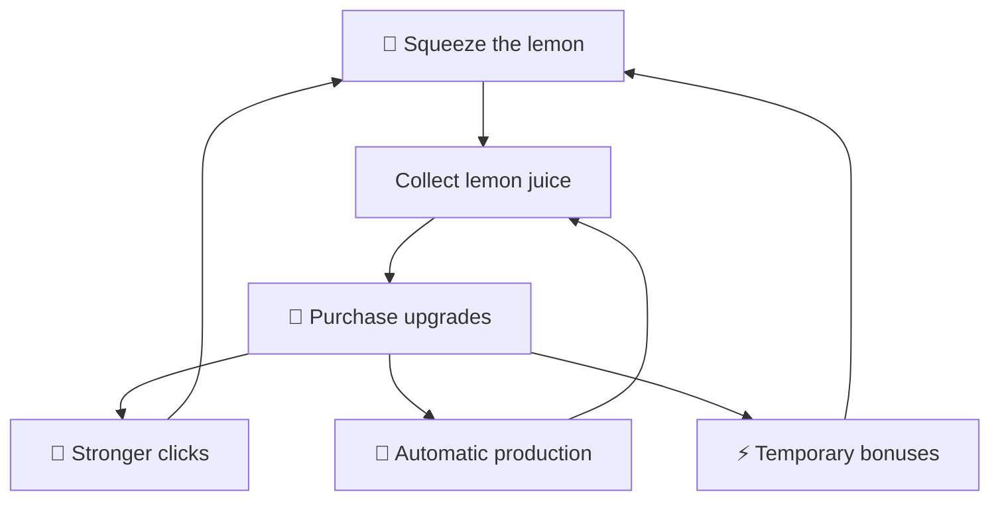

# 🍋 LemonSqueezer

**Squeeze lemons. Earn juice. Upgrade your tools. Keep growing.**

Developed by **Lemon Team** — *Equipo Limón*.

---

## Info

LemonSqueezer is a browser-based incremental clicker game developed by
@ZaneDevv, @Vimobo and @ProfitCoder.

This project started with a simple idea: challenge ourselves to build
something different from our usual DAW coursework. We wanted to explore
game development, improve our skills and create a game we could enjoy
together.

The project is under development. Features and balancing may change.

## 🍋 About the Game

Click the lemon to collect lemon juice, purchase upgrades and improve
your production.

Choose how to spend your earnings: increase the juice earned per click,
invest in automatic production or unlock temporary bonuses.

### Features

| Feature | What it does |
| :--- | :--- |
| 🍋 Manual squeezing | Collect juice by clicking the lemon. |
| 🔧 Click upgrades | Increase the juice earned per squeeze. |
| 🌳 Automatic squeezers | Generate juice over time. |
| ⚡ Active upgrades | Activate temporary bonuses. |
| 👕 Customisation | Dress your lemon with clothing and accessories. |
| 🎨 Pixel-art interface | Wooden panels, animations and sound effects. |

### How Progression Works

## Technologies

| Technology | Purpose |
| :--- | :--- |
| HTML | Page structure and game interface. |
| CSS | Layout, responsive design and visual styling. |
| JavaScript | Game logic, interactions, menus and animations. |

## Development Team

| Developer | GitHub |
| :--- | :--- |
| ZaneDevv | [@ZaneDevv](https://github.com/ZaneDevv) |
| Vimobo | [@Vimobo](https://github.com/Vimobo) |
| ProfitCoder | [@ProfitCoder](https://github.com/ProfitCoder) |

**Team name:** Lemon Team  
**Spanish name:** Equipo Limón

---

## ⚠️ Copyright and Permissions

> ⚠️ **ALL RIGHTS RESERVED**
>
> Copying, modifying, redistributing or commercially exploiting protected
> project material requires prior written permission from the relevant
> rights holders, subject to applicable legal exceptions and hosting
> platform terms.
>
> Unauthorised use may lead to legal action.

Copyright © 2026 the respective authors of Lemon Team.
All rights reserved in their original contributions.

**LemonSqueezer is not offered under an open-source licence.**

Unless expressly authorised in writing by the relevant rights holders,
you may not:

- Copy or redistribute protected project material.
- Modify or republish protected code or assets.
- Incorporate protected parts into another project.
- Sell or commercially exploit protected project material.

This includes original source code, documentation, artwork and audio
owned by the team. **Giving credit does not replace permission.**

Access to this repository does not, by itself, grant a licence to reuse
its protected content.

These restrictions are subject to applicable legal exceptions and any
rights granted under the applicable terms of the repository hosting
platform.

Third-party assets and dependencies remain subject to their respective
ownership and licence terms. This notice does not claim ownership of them.

Copyright protects original expression, including qualifying software,
rather than the general idea of a lemon clicker game or its mechanics.

## 🚨 Legal Enforcement

The relevant rights holders reserve the right to request the removal
of infringing content, seek an injunction and claim damages where
available under applicable law.

Legal remedies depend on the circumstances and jurisdiction.
This notice does not create automatic fines or penalties.

## Legal References

### Spain

**Royal Legislative Decree 1/1996 of 12 April — Spanish Intellectual
Property Law:**

| Articles | Subject |
| :--- | :--- |
| Article 17 | Exclusive exploitation rights. |
| Articles 96–100 | Computer program protection, ownership, exploitation rights and statutory limitations. |
| Articles 138–141 | Enforcement, cessation of infringement, compensation and interim measures. |

[Read the official text — BOE](https://www.boe.es/eli/es/rdlg/1996/04/12/1/con)

### International Framework

**Berne Convention for the Protection of Literary and Artistic Works**

Establishes international copyright protection principles, including
national treatment and protection without formal registration requirements.

[Official summary — WIPO](https://www.wipo.int/en/web/treaties/ip/berne/summary_berne)

**WIPO Copyright Treaty — Article 4**

Recognises protection for computer programs as literary works.

[Official summary — WIPO](https://www.wipo.int/en/web/treaties/ip/wct/summary_wct)

**TRIPS Agreement — Article 10(1)**

Provides for the protection of computer programs in source or object code
as literary works under the Berne Convention.

[Official text — WTO](https://www.wto.org/english/docs_e/legal_e/27-trips_04_e.htm)

International protection and enforcement operate through applicable
national laws and treaty obligations; there is no single worldwide
copyright enforcement system.

## Permission Requests

For permission to reuse protected project material, contact the team
through the developers' GitHub profiles.

**Permission must be obtained before the proposed use.**

---

🍋 **Developed by Lemon Team — Equipo Limón**
